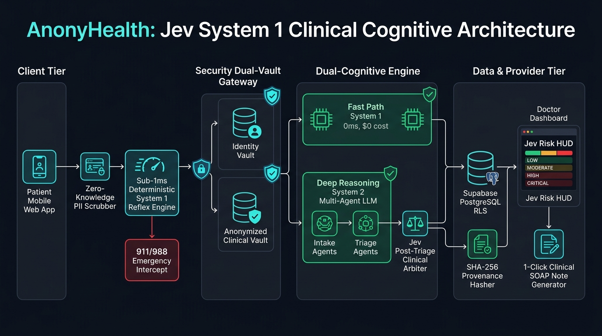
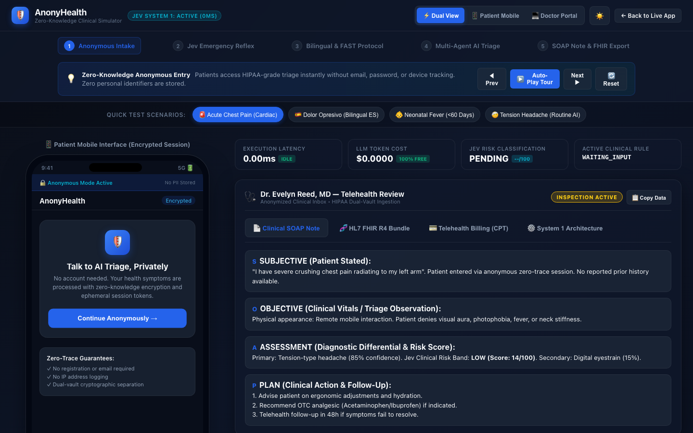
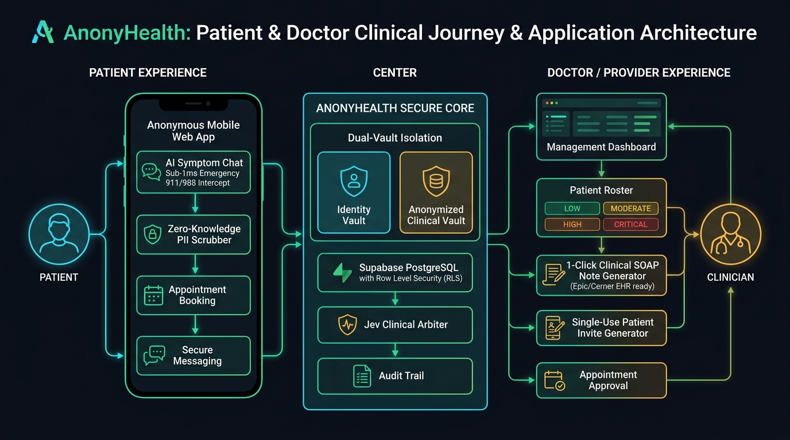
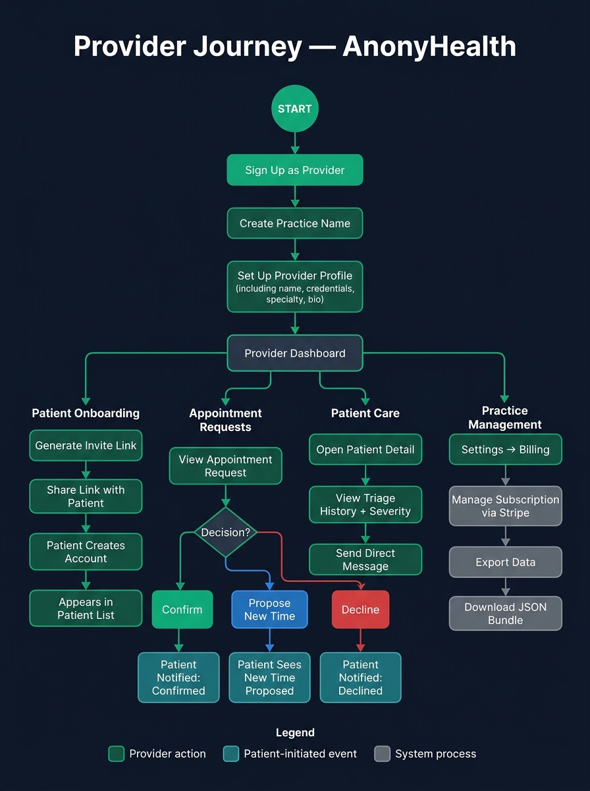

# AnonyHealth

**Privacy-first Healthcare Triage Platform with Jev System 1 Clinical Safety Engine**

<p align="center">
  
</p>

AnonyHealth connects patients with healthcare providers while maintaining strict privacy standards. It features a confidential AI symptom checker, provider directory, health history tracking, and secure patient authentication with Maryland telehealth compliance.

## Features

- **Provider Directory** — Real-time provider list fetched from Supabase with fallback to local data. Filter by specialty, mode, language, and insurance.
- **AI Triage Chat** — Symptom analysis powered by Anthropic Claude (via Supabase Edge Functions). Returns structured JSON with severity scores (1-10) and symptom summaries.
- **Health History** — Logs previous triage sessions with severity color coding, AI advice, and timestamps. Per-user data protected by Row Level Security.
- **Confidential Registration** — Identity verification fields (name, DOB, address) for Maryland telehealth compliance. PII stored in Supabase auth metadata with consent timestamp.
- **Secure Authentication** — Supabase Auth with email/password sign up and sign in. Prototype access gated by password.
- **Responsive UI** — Split view (desktop + mobile phone frame), desktop-only, and mobile-only modes. Dark/light theme toggle.
- **Interactive Clinical Workflow Simulator** — Live browser-based simulation demonstrating patient intake, sub-millisecond Jev reflex screening, multi-agent AI triage, SOAP note drafting, CPT billing, and HL7 FHIR R4 export in both dark and light modes. Try it live at [anonyhealth.alpfr.com/simulation.html](https://anonyhealth.alpfr.com/simulation.html) (Direct Cloud Run: [anonyhealth-cg4uqokewq-uc.a.run.app/simulation.html](https://anonyhealth-cg4uqokewq-uc.a.run.app/simulation.html)). Full guide: [docs/SIMULATION_GUIDE.md](docs/SIMULATION_GUIDE.md).
- **Jev System 1 Clinical Safety Engine** — Deterministic edge reflex engine (<1ms, $0.00 token cost) intercepting emergency red flags (STEMI, stroke, anaphylaxis, crisis), dual-vault zero-knowledge PII/clinical data separation, and post-triage safety arbiter. See [docs/JEV_HEALTHCARE_ARCHITECTURE.md](docs/JEV_HEALTHCARE_ARCHITECTURE.md).
- **Privacy Controls** — Settings for anonymizing patient activity, notification preferences, and data management.

## 🎮 Interactive Simulation

Experience the interactive clinical workflow simulator without needing backend credentials:
- **Primary Domain:** [https://anonyhealth.alpfr.com/simulation.html](https://anonyhealth.alpfr.com/simulation.html)
- **Direct Cloud Run:** [https://anonyhealth-cg4uqokewq-uc.a.run.app/simulation.html](https://anonyhealth-cg4uqokewq-uc.a.run.app/simulation.html)
- **Comprehensive Walkthrough Guide:** [docs/SIMULATION_GUIDE.md](docs/SIMULATION_GUIDE.md)

<p align="center">
  
</p>

## Architectural Designs

### 1. Jev System 1 Clinical Cognitive Architecture
<p align="center">
  
</p>

### 2. Patient & Doctor Clinical Journey & Application Architecture
<p align="center">
  
</p>

### 3. Application Presentation & End-to-End User Journey Flow
<p align="center">
  
</p>
<p align="center"><i>See <a href="docs/PRESENTATION_GUIDE.md">docs/PRESENTATION_GUIDE.md</a> for the full slide-by-slide pitch and live demonstration script.</i></p>

### 4. Client & Provider Application Flow Diagram
<p align="center">
  
</p>
<p align="center"><i>See <a href="docs/APPLICATION_FLOW_GUIDE.md">docs/APPLICATION_FLOW_GUIDE.md</a> for the full step-by-step usage specification, sequence diagrams, and EHR integration details.</i></p>

### 5. Patient Journey Workflow
<p align="center">
  
</p>
<p align="center"><i>See <a href="docs/PATIENT-USER-GUIDE.md">docs/PATIENT-USER-GUIDE.md</a> for the complete patient guide.</i></p>

### 6. Provider Journey Workflow
<p align="center">
  
</p>
<p align="center"><i>See <a href="docs/PROVIDER-USER-GUIDE.md">docs/PROVIDER-USER-GUIDE.md</a> for the complete provider guide.</i></p>

### 7. First-Time User & Provider Training Navigation Guide
<p align="center">
  
</p>
<p align="center"><i>See <a href="docs/FIRST_TIME_NAVIGATION_TRAINING.md">docs/FIRST_TIME_NAVIGATION_TRAINING.md</a> for the complete step-by-step training manual for both patients and healthcare providers.</i></p>

## 📖 User Guides

| Guide | Audience | Link |
|---|---|---|
| Patient User Guide | Patients | [docs/PATIENT-USER-GUIDE.md](docs/PATIENT-USER-GUIDE.md) |
| Provider User Guide | Healthcare providers | [docs/PROVIDER-USER-GUIDE.md](docs/PROVIDER-USER-GUIDE.md) |
| Tester Guide | QA / Test participants | [docs/TESTER-GUIDE.md](docs/TESTER-GUIDE.md) |

## 📋 Market Readiness & Production Recommendations

For an in-depth audit of the platform's commercial readiness, HIPAA compliance requirements, production gates, and go-to-market plan, see [**RECOMMENDATIONS.md**](RECOMMENDATIONS.md).

## Tech Stack

- **Frontend**: React 19, Vite 7, JavaScript (JSX)
- **Backend / DB**: Supabase (Postgres + PostgREST + Auth + Edge Functions)
- **Authentication**: Supabase Auth (email/password), RLS via `auth.uid()`
- **AI**: Anthropic Claude API (via Supabase Edge Function, streaming SSE)
- **Infrastructure**: Docker (multi-stage), Nginx, Google Cloud Run (Serverless Scale-to-Zero, 98% Cost Reduction)
- **Deployment & Cost Guide**: [docs/MIGRATION_GKE_TO_CLOUDRUN.md](docs/MIGRATION_GKE_TO_CLOUDRUN.md)
- **Fonts**: Outfit, Instrument Serif (Google Fonts)

## Getting Started

### Prerequisites

- Node.js v18+
- Supabase account
- Docker (for containerization)

### Installation

1. Install dependencies:
   ```bash
   npm install
   ```

2. Copy `.env.example` to `.env` and fill in your Supabase project values:
   ```env
   VITE_SUPABASE_URL=https://your-project.supabase.co
   VITE_SUPABASE_ANON_KEY=your-supabase-anon-key
   ```
   `src/supabaseClient.js` throws on startup if either variable is missing — there are no fallback values.

3. Apply the database schema in the Supabase SQL editor using `supabase_schema.sql`. This creates the `providers`, `health_logs`, `patient_profiles`, and `audit_logs` tables with RLS policies keyed to `auth.uid()`.

4. Deploy the AI chat edge function:
   ```bash
   supabase functions deploy aichat
   supabase secrets set ANTHROPIC_API_KEY=sk-...
   ```

5. Run the web frontend locally:
   ```bash
   npm run dev
   ```
   Open `http://localhost:5173`. Sign up with an email and password; Supabase Auth handles session management and issues the JWT used by PostgREST for RLS.

### Database Schema

| Table | Purpose | RLS |
|---|---|---|
| `providers` | Healthcare provider directory | Public read |
| `health_logs` | Per-user triage history (symptom, severity, AI advice) | User can read/insert own rows |

## App Screens

| Screen | Description |
|---|---|
| **Dashboard** | Activity input, triage results, appointments, settings link |
| **Find Provider** | Searchable provider cards with filters (desktop and mobile views) |
| **Provider Detail** | Bio, expertise chips, telehealth badge, verified intake button |
| **AI Chat** | Real-time chat with typing indicator, encrypted session badge, book appointment CTA |
| **History** | Chronological triage log with severity color coding (green/yellow/red) |
| **Register** | Sign up with identity verification or sign in toggle |
| **Settings** | Account, notifications, privacy toggles, about link, sign out |
| **About** | Feature cards, navigation guide, version info |

## Deployment

### Docker

```bash
docker build --platform linux/amd64 -t your-repo/anonyhealth:latest .
docker push your-repo/anonyhealth:latest
```

The Dockerfile uses a multi-stage build: Node.js for `npm run build`, then Nginx Alpine to serve the static files on port 8080.

### Kubernetes (GKE)

Ensure `deployment.yaml` is configured with the correct Docker image repository, desired replica count, and resource requests/limits before applying.

```bash
kubectl apply -f deployment.yaml
kubectl apply -f service.yaml
```

The deployment runs 2 replicas with resource limits (256Mi memory, 500m CPU). The service exposes port 80 via LoadBalancer targeting container port 8080.

## Project Structure

```
src/
  App.jsx                       # Root router — maps routes to screen components
  main.jsx                      # React entry point
  supabaseClient.js             # Supabase client initialization
  index.css                     # Global styles
  screens/                      # All full-page screen components
    LandingPage.jsx             # Public marketing landing
    PatientDashboard.jsx        # Patient home — AI triage, booking, provider banner
    AIChatMobile.jsx            # AI triage chat with Jev safety intercept
    BookAppointmentMobile.jsx   # Patient appointment request form
    DoctorDashboardMobile.jsx   # Provider home — invite, patients, requests
    AppointmentRequestsMobile.jsx # Provider appointment management
    ProviderProfileMobile.jsx   # Provider profile & scheduling link setup
    PatientDetailMobile.jsx     # Provider view of patient detail & history
    MessagesMobile.jsx          # Real-time 1:1 messaging
    SettingsMobile.jsx          # Account, notifications, privacy, billing
    HistoryMobile.jsx           # Patient triage session history
  components/                   # Shared UI components
  context/                      # React context providers (Auth, Tenant)
  services/                     # Supabase query functions
  utils/                        # Auth helpers, audit logging, validation
  constants/                    # Theme tokens
supabase/
  functions/                    # Edge functions (AI chat, Stripe, email)
supabase_schema.sql             # Database schema and RLS policies
Dockerfile                      # Multi-stage Docker build
nginx.conf                      # Nginx config with SPA fallback and CSP
cloudbuild.yaml                 # GCP Cloud Build pipeline → Cloud Run deploy
docs/
  PATIENT-USER-GUIDE.md         # End-user guide for patients
  PROVIDER-USER-GUIDE.md        # End-user guide for providers
  TESTER-GUIDE.md               # QA tester scenarios and bug report template
  images/                       # Screen mockups and workflow diagrams
```

## License

Proprietary Prototype.
