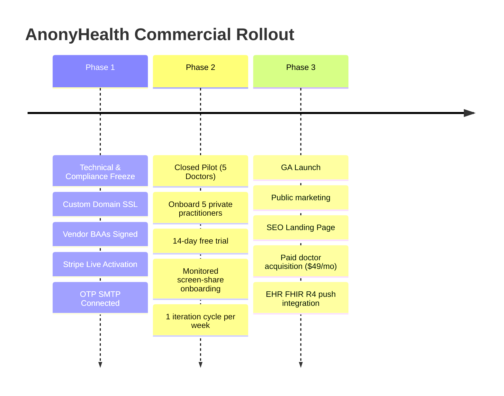

# AnonyHealth — Market Readiness & Production Recommendations

> **Evaluation Date:** October 2, 2026  
> **Target Cloud:** Google Cloud Run (`us-central1`)  
> **Entity:** ALPFR LLC (Hanover, MD)  
> **Readiness Rating:** **85% — Pilot Ready (Closed Beta)**  
> **Primary Gate:** HIPAA BAA Execution & Stripe Live Activation

---

## 1. Executive Summary

AnonyHealth is an autonomous, privacy-first telehealth and AI clinical triage platform ("Private Practice in a Browser"). It enables solo healthcare providers and private practices to manage patient onboarding, bilingual deterministic emergency triage (Jev System 1), zero-knowledge PII sanitization, encrypted messaging, and HL7 FHIR R4 export without incurring costly cloud infrastructure overhead.

Following the recent migration from a 24/7 GKE cluster down to scale-to-zero **Google Cloud Run**, monthly infrastructure baseline costs have dropped by ~98% (from ~$240/month down to <$5/month).

### Market Readiness Verdict
* **Closed Pilot (5 Providers):** **READY** — Technical, clinical safety, and data isolation architectures are completely solid and verified.
* **Public General Availability (GA):** **BLOCKED ON 4 COMPLIANCE GATES** — Requires executed Business Associate Agreements (BAAs), production Stripe activation, transactional email domain setup, and branded custom domain SSL completion.

---

## 2. Market Readiness Scorecard

```
┌─────────────────────────────────────────────────────────────┐
│                   MARKET READINESS AUDIT                    │
├────────────────────────────────┬──────────┬─────────────────┤
│ Pillar                         │ Score    │ Status          │
├────────────────────────────────┼──────────┼─────────────────┤
│ 1. Clinical Safety & Triage    │   95%    │  Production     │
│ 2. Cloud Architecture & FinOps │   95%    │  Production     │
│ 3. Security, Auth & RLS        │   90%    │  Production     │
│ 4. Commercial & Monetization   │   65%    │  Needs Config   │
│ 5. Legal & HIPAA Compliance    │   55%    │  Action Needed  │
└────────────────────────────────┴──────────┴─────────────────┘
```

| Dimension | Score | Current Status | Key Attributes & Gaps |
| :--- | :---: | :---: | :--- |
| **1. Clinical Safety Engine** | **95%** | **Production** | Bilingual (EN/ES) red-flag screening, FAST stroke & cardiac triage, 988 crisis interception, zero-knowledge PII scrubbing, HL7 FHIR R4 export. 21/21 unit tests automated in CI. |
| **2. Cloud Architecture** | **95%** | **Production** | Fully migrated to Cloud Run (`us-central1`). Scale-to-zero enabled, concurrency set to 250, Nginx security headers hardened. All GKE nodes stopped. |
| **3. Security & Governance** | **90%** | **Production** | Row Level Security (RLS) active on all tables, tamper-evident audit trigger, CSP + HSTS active, CORS origin allowlisting enforced. |
| **4. Commercial Billing** | **65%** | **Pending** | Stripe Checkout, Customer Portal, and subscription webhooks built for $49/mo doctor tier. Currently configured with test keys (`sk_test_...`). |
| **5. Legal & HIPAA Floor** | **55%** | **Pending** | Legal terms and privacy notices finalized for ALPFR LLC (Maryland venue). Vendor BAAs (Google Cloud, Supabase) must be executed before processing live PHI. |

---

## 3. High-Impact Enhancements Implemented

The following critical enhancements were recently applied and verified:

1. **Nginx Security Header Hardening (`nginx.conf`):**
   - Fixed Nginx child-block inheritance bug where `location = /index.html` and `location /assets/` dropped parent security headers.
   - Enforced `X-Frame-Options: DENY`, `X-Content-Type-Options: nosniff`, `Strict-Transport-Security`, and `Permissions-Policy` across all routes.
   - Added Sentry telemetry ingest endpoints (`*.ingest.sentry.io`) to `connect-src` CSP directive.
2. **CORS Edge Function Allowlisting (`supabase/functions/_shared/cors.ts`):**
   - Added default allowed origins covering the live Cloud Run endpoint (`anonyhealth-cg4uqokewq-uc.a.run.app`) and custom domains (`*.alpfr.com`, `*.opssightai.com`).
3. **CI/CD Safety Gate (`.github/workflows/deploy.yml`):**
   - Integrated `npm run test:unit` directly into GitHub Actions deployment pipeline to guarantee that red-flag triage regressions block builds before deployment.
4. **Cloud Run Concurrency & FinOps (`cloudbuild.yaml`):**
   - Configured `--concurrency=250` in Cloud Run to prevent unnecessary container scale-outs under burst traffic.
5. **Legal & Entity Finalization (`src/screens/LegalPage.jsx`):**
   - Replaced all template placeholders with ALPFR LLC corporate details, Hanover MD physical address, dedicated compliance emails, and Maryland state jurisdiction.
6. **Telemetry & Repository Cleanliness:**
   - Moved BigQuery and Vertex AI Gemini logging scripts into [`scripts/telemetry/`](scripts/telemetry/) with a dedicated `requirements.txt`.
   - Archived decommissioned GKE manifests to [`k8s-legacy/`](k8s-legacy/).
   - Modernized [`scripts/smoke-test.sh`](scripts/smoke-test.sh) to validate Cloud Run service health.

---

## 4. The 4 Mandatory Pilot Gates (Action Required)

Before onboarding the first cohort of paying doctors and patients, execute the following 4 gates:

### Gate A: Complete Branded Domain SSL (5 Minutes)
Your direct Cloud Run endpoint (`https://anonyhealth-cg4uqokewq-uc.a.run.app`) is active. For patient and doctor trust, activate your custom domain:

* **Option 1 (`anonyhealth.alpfr.com` — Recommended):**
  Log into your **Squarespace Domains** DNS settings for `alpfr.com` and add:
  ```text
  Type:    CNAME
  Host:    anonyhealth
  Target:  ghs.googlehosted.com.
  TTL:     300 (or Default)
  ```
  *Google Cloud Run will automatically complete SSL provisioning once the CNAME resolves.*

* **Option 2 (`anonyhealth.opssightai.com`):**
  AWS Route 53 is already updated to `ghs.googlehosted.com.`. Open [Google Search Console](https://search.google.com/search-console/welcome?authuser=0&new_domain_name=opssightai.com), enter `opssightai.com`, and click **Verify**. Then notify the agent to register the mapping.

---

### Gate B: Execute Vendor BAAs (HIPAA Floor)
Under 45 CFR § 164.502(e), you cannot legally store or transmit Protected Health Information (PHI) without signed Business Associate Agreements:

1. **Google Cloud Platform:**
   - Log into Google Cloud Console $\rightarrow$ **IAM & Admin** $\rightarrow$ **Compliance**.
   - Review and accept the **Google Cloud HIPAA Business Associate Amendment (BAA)**.
2. **Supabase:**
   - Upgrade your Supabase organization to the **Team Tier**.
   - Navigate to Organization Settings $\rightarrow$ **Legal & Compliance** and electronically execute the **Supabase HIPAA BAA**.
3. **Anthropic / Vertex AI:**
   - If clinical chat interacts with live patient symptoms, execute a BAA with your AI provider, or ensure the client-side Jev System 1 engine redacts all 18 HIPAA Safe Harbor identifiers before calling the API.

---

### Gate C: Flip Stripe to Live Mode ($49/month Doctor Subscription)
1. **Stripe Dashboard (Toggle from "Test" to "Live"):**
   - Complete business profile, bank account payout, and identity verification.
   - Create a recurring Product: `AnonyHealth Doctor Subscription` at **$49.00 / month**.
   - Copy the Live Price ID (`price_...`).
2. **Configure Live Webhooks:**
   - Add endpoint: `https://exzmdnnkbjjgrtwnjemm.supabase.co/functions/v1/stripe-webhook`
   - Subscribe to events:
     - `checkout.session.completed`
     - `customer.subscription.created`
     - `customer.subscription.updated`
     - `customer.subscription.deleted`
     - `invoice.payment_failed`
   - Copy the signing secret (`whsec_...`).
3. **Update Supabase Secrets:**
   - `STRIPE_SECRET_KEY` = `sk_live_...`
   - `STRIPE_PRICE_ID_DOCTOR_MONTHLY` = `price_...`
   - `STRIPE_WEBHOOK_SECRET` = `whsec_...`
4. **Self-Verification:**
   - Complete 1 test subscription using a real card, verify that your account status changes to `active` or `trialing`, and refund yourself.

---

### Gate D: Set Up Dedicated Transactional Email (OTP Delivery)
Currently, authentication OTP emails rely on Supabase's built-in default mailer, which enforces a strict limit of 3–4 emails per hour and lacks a HIPAA BAA.

1. Create an account with **AWS SES**, **SendGrid**, or **Postmark**.
2. Verify domain `alpfr.com` or `opssightai.com` (DKIM, SPF, and DMARC records).
3. In Supabase Dashboard $\rightarrow$ **Authentication** $\rightarrow$ **Email Settings** $\rightarrow$ Enable Custom SMTP:
   - Host, Port (587), Username, and SMTP Password.
4. Execute a BAA with your transactional email provider.

---

## 5. Phased Go-to-Market Roadmap



### Phase 1: Closed Pilot Launch (Next 7 Days)
* Do **not** run broad public ads.
* Target **5 solo practitioners** (Primary Care, Mental Health, or Concierge Medicine) in Maryland or target jurisdictions.
* Offer a **14-day free trial** in exchange for a 30-minute recorded onboarding session and structured clinical feedback.
* Validate key workflows:
  1. Doctor signup & Stripe trial activation.
  2. Doctor invites patient via encrypted SMS/email token link.
  3. Patient completes zero-knowledge symptom intake.
  4. Clinician reviews SOAP note and downloads HL7 FHIR R4 JSON bundle.

### Phase 2: Pilot Validation & Refinement (Days 8–30)
* Track pilot telemetry using [`scripts/telemetry/get_gemini_prompts_logs.py`](scripts/telemetry/get_gemini_prompts_logs.py) to measure token efficiency, latency, and triage classification distribution.
* Measure provider retention and time saved per clinical encounter.
* Refine custom billing rules (CPT codes 99421–99423) based on clinician input.

### Phase 3: General Commercial Availability (Day 30+)
* Launch public provider acquisition via targeted medical association partnerships and digital channels.
* Enable direct EHR ingestion (pushing FHIR R4 Encounter bundles directly into Epic/Cerner/AthenaHealth via SMART on FHIR).

---

## 6. Architecture & Maintenance Reference

* **Cloud Run Service:** `anonyhealth` (`us-central1`)
* **Live Service URL:** `https://anonyhealth-200624997525.us-central1.run.app`
* **Deploy Command:** `./scripts/deploy-cloudrun.sh`
* **Automated CI/CD:** Push to branch `main` triggers `.github/workflows/deploy.yml`
* **Clinical Engine Tests:** `npm run test:unit`
* **Integration Tests:** `npm run test` (Playwright)
* **Smoke Test Probe:** `./scripts/smoke-test.sh --base-url <ENDPOINT>`
