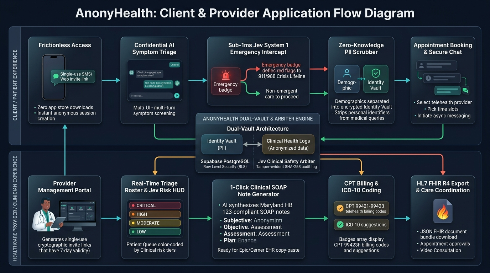
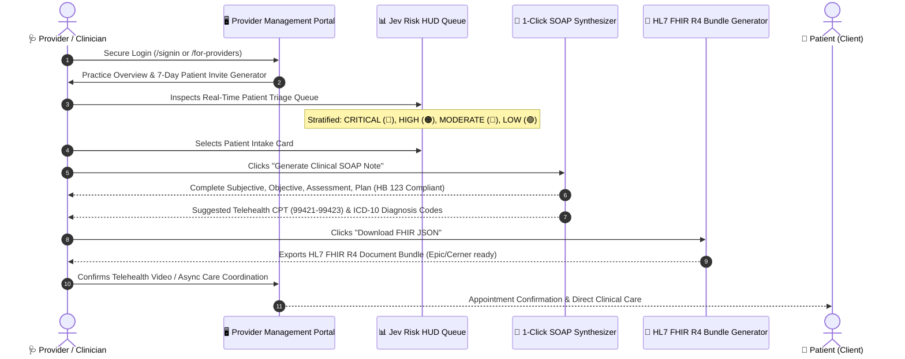

# AnonyHealth — Client & Provider Application Flow Specification

> **Platform:** AnonyHealth Confidential Telehealth Triage Platform  
> **Engine:** Jev System 1 Dual-Cognitive Arbiter (Reflex + Deep Synthesis)  
> **Compliance Standards:** HIPAA Title II, Maryland Telehealth Act (HB 123), HL7 FHIR R4, SOC 2 Type II  
> **Target Cloud Topology:** Google Cloud Run / GKE + Supabase PostgreSQL (Row-Level Security)

---

## 1. End-to-End Application Flow Diagram

<p align="center">
  
</p>

The AnonyHealth platform is architected around two parallel, synchronized user experiences bridged by an ultra-secure, zero-knowledge core:
1. **Client / Patient Experience (Top Track):** Zero-friction, anonymous mobile web application enabling confidential symptom screening, sub-millisecond emergency red-flag deflection, and self-service appointment booking.
2. **Provider / Clinician Experience (Bottom Track):** Real-time clinical command center providing patient risk stratification (Jev Risk HUD), 1-click clinical SOAP note drafting, automated CPT/ICD-10 coding, and HL7 FHIR R4 document export.
3. **AnonyHealth Dual-Vault & Arbiter Core (Center):** Cryptographic isolation between patient demographics (Identity Vault) and de-identified medical symptoms (Clinical Vault), governed by Supabase Row-Level Security (RLS) and Jev tamper-evident SHA-256 audit logging.

---

## 2. Client / Patient Application Flow (Top Swimlane)

```mermaid
sequenceDiagram
    autonumber
    actor Patient as 👤 Patient (Client)
    participant Edge as 🌐 Cloud Run Edge / Nginx
    participant JevReflex as ⚡ Jev System 1 (<1ms)
    participant MultiAgent as 🤖 Claude 3.5 Triage
    participant Vault as 🔐 Dual-Vault (Postgres RLS)
    actor Doctor as 🩺 Provider (Doctor)

    Note over Patient,Edge: Phase 1: Zero-Friction Ingress
    Patient->>Edge: Opens SMS/Email Invite (/invite/:token) or Web
    Edge->>Patient: Instant Mobile Web App (Zero App Store / Anonymous Session)

    Note over Patient,JevReflex: Phase 2: Symptom Intake & Emergency Screening
    Patient->>Edge: Inputs Chief Complaint ("Crushing chest pain...")
    Edge->>JevReflex: Deterministic AST & Regex Red-Flag Scan (<1ms)
    alt Emergency Red Flag Detected (STEMI, Stroke, 988 Crisis)
        JevReflex-->>Patient: 🚨 IMMEDIATE 911 / 988 DEFLECTION MODAL (Zero LLM Wait)
    else Nominal / Non-Emergent Complaint
        JevReflex->>MultiAgent: Sanitized Inquiry (PII Scrubbed)
        MultiAgent-->>Patient: Interactive Q&A + Severity Score (1-10) + Home Care Plan
    end

    Note over Patient,Vault: Phase 3: Booking & PII Isolation
    Patient->>Vault: Confirms Booking + Enters Demographics (Maryland HB 123)
    Vault->>Vault: PII locked in Identity Vault; Symptoms in Clinical Vault
    Vault-->>Doctor: Real-Time Roster Alert (Jev Risk HUD)
```

### Detailed Patient Workflow Stages

#### Stage 1: Frictionless Access & Zero App Friction
- **Patient Entrypoint:** Patient clicks a single-use invite link (`https://anonyhealth.com/invite/<cryptographic-token>`) sent via SMS or email by their healthcare provider, or accesses the public portal directly.
- **Zero App Store Download:** The application renders instantly as a Progressive Web Application (PWA) in any mobile or desktop browser (iOS Safari, Android Chrome, desktop).
- **Anonymous Session Initialization:** Supabase Auth instantiates an anonymous session token stored securely in client-side memory, allowing immediate clinical triage without forcing an upfront registration form or credit card wall.

#### Stage 2: Confidential AI Symptom Triage (`AIChatMobile.jsx`)
- **Conversational Intake:** Patient describes their chief complaint naturally in free-form language (English or Spanish).
- **Adaptive Probing:** The intake agent engages in a focused, single-question-per-turn clinical dialogue gathering onset, duration, severity, and anatomical location.

#### Stage 3: Sub-1ms Jev System 1 Emergency Intercept
- **Deterministic Red-Flag Matching:** Before any request reaches external LLM APIs, the Jev System 1 edge reflex engine screens the input against curated clinical emergency taxonomies:
  - *Cardiovascular:* Acute myocardial infarction (chest pressure, pain radiating to left jaw/arm).
  - *Neurological:* FAST stroke symptoms (facial droop, arm weakness, slurred speech).
  - *Respiratory:* Severe dyspnea, cyanosis, anaphylactic stridor.
  - *Mental Health Crisis:* Active suicidal ideation, intent, or self-harm keywords.
- **Instant Deflection (<1ms, $0.00 Token Cost):** If an acute red flag triggers, the system immediately suspends AI conversation and renders an unmistakable audio/visual emergency intercept with direct click-to-call buttons for **911**, the **988 Suicide & Crisis Lifeline**, and the National Poison Control Center.

#### Stage 4: Zero-Knowledge PII Scrubber & Identity Vault
- **Client-Side Redaction:** Regular expressions and entity recognition strip phone numbers, Social Security numbers, email addresses, and physical addresses from the chat payload before transmission to inference endpoints.
- **Dual-Vault Segregation:** Demographic data collected for state telehealth regulatory requirements (e.g., Maryland HB 123) is stored in the encrypted `patient_profiles` table, strictly decoupled from the clinical observations in `health_logs`.

#### Stage 5: Telehealth Booking & Asynchronous Messaging
- **Provider Directory Filtering:** Patients can browse vetted, state-licensed healthcare providers filtered by specialty, telehealth availability, accepted insurance networks, and spoken languages.
- **Secure Appointment Request:** Patient selects an appointment time slot and securely submits their de-identified symptom history to the physician for review.

---

## 3. Provider / Clinician Application Flow (Bottom Swimlane)



### Detailed Provider Workflow Stages

#### Stage 1: Provider Management Portal (`DoctorDashboardMobile.jsx`)
- **Verified Access:** Clinicians log into their dedicated practice portal, backed by Supabase Auth with multi-factor authentication and role-based access control (`role: 'provider'`).
- **Cryptographic Patient Invite Generator:** Clinicians can generate single-use, time-limited (7-day validity) invitation links that allow designated patients to bypass intake queues and connect directly with their panel.

#### Stage 2: Real-Time Patient Triage Queue & Jev Risk HUD
- **Automated Clinical Stratification:** As patient triage sessions conclude, incoming cases are instantly prioritized into color-coded clinical risk bands:
  - 🔴 **CRITICAL:** Emergency red-flag trigger or severity score 9–10. Requires immediate medical intervention.
  - 🟠 **HIGH:** Urgent condition requiring provider consultation within 12–24 hours (severity 7–8).
  - 🔵 **MODERATE:** Routine clinical visit appropriate for scheduling within 3–5 days (severity 4–6).
  - 🟢 **LOW:** Mild symptoms suitable for home care, OTC guidance, and proactive monitoring (severity 1–3).

#### Stage 3: 1-Click Clinical SOAP Note Synthesis (`PatientDetailMobile.jsx`)
- **Eliminating Charting Burnout ("Pajama Time"):** Doctors typically spend 2+ hours each evening documenting patient encounters. With a single click, AnonyHealth's clinical synthesis engine structures the patient's triage history into an industry-standard **SOAP** note:
  - **S (Subjective):** Patient's chief complaint, history of present illness (HPI), reported severity, symptom duration, and aggravating factors.
  - **O (Objective):** Reported vitals, AI triage telemetry, verified demographics, and emergency red-flag exclusion status.
  - **A (Assessment):** Clinical impression, differential considerations, and Jev risk classification.
  - **P (Plan):** Recommended clinical next steps, diagnostic workups, patient instructions, and follow-up timeline.
- **Statutory Compliance:** Embeds mandatory **Maryland Telehealth Act (HB 123)** disclosure statements and patient consent verification timestamps.

#### Stage 4: Automated CPT Billing & ICD-10 Decision Support
- **Digital Health Reimbursement:** The engine cross-references triage encounter length and complexity to propose reimbursable telehealth codes:
  - **CPT 99421:** Online digital evaluation and management service; 5–10 minutes cumulative time.
  - **CPT 99422:** Online digital evaluation and management service; 11–20 minutes cumulative time.
  - **CPT 99423:** Online digital evaluation and management service; 21+ minutes cumulative time.
- **Diagnostic Mapping:** Suggests heuristic ICD-10 diagnosis codes (e.g., `R05.9` Cough, `R50.9` Fever) to accelerate billing submission.

#### Stage 5: Interoperable EHR Export & Care Delivery
- **HL7 FHIR R4 Bundle Export:** Clinicians can download or stream an HL7 FHIR R4 JSON document bundle incorporating `Patient`, `Condition`, `Encounter`, `Observation`, and `DocumentReference` resources, designed for direct ingestion into hospital EHR systems (Epic Systems, Oracle Cerner, AthenaHealth).
- **Closed-Loop Follow-Up:** Provider approves appointment requests, launches integrated HIPAA-compliant video consultations, or dispatches secure async treatment plans.

---

## 4. Central Core: AnonyHealth Dual-Vault & Arbiter Engine

```
┌────────────────────────────────────────────────────────────────────────┐
│                   ANONYHEALTH SECURE PLATFORM CORE                     │
├──────────────────────────────────┬─────────────────────────────────────┤
│      IDENTITY VAULT (PII)        │   CLINICAL VAULT (DE-IDENTIFIED)    │
│  - patient_profiles table        │   - health_logs table               │
│  - Legal Name, DOB, Phone, Address│  - Symptoms, Onset, Duration        │
│  - Maryland HB 123 Consent Time  │   - AI Severity Score (1-10)        │
│  - AES-256 Storage Encryption    │   - Differential Summaries          │
├──────────────────────────────────┴─────────────────────────────────────┤
│         SUPABASE POSTGRESQL WITH ROW LEVEL SECURITY (RLS)              │
│  - auth.uid() Isolation: Patients can only read their own records     │
│  - Doctor Isolation: Providers only read authorized panel patients     │
├────────────────────────────────────────────────────────────────────────┤
│                   JEV CLINICAL SAFETY ARBITER                          │
│  - Post-Triage Validation: Blocks non-approved pharmaceutical advice   │
│  - Tamper-Evident Ledger: SHA-256 HMAC cryptographic checksums         │
│  - 15-Minute Session Inactivity Cache Flush                            │
└────────────────────────────────────────────────────────────────────────┘
```

---

## 5. Summary Table: Client vs. Provider Usage Matrix

| Feature / Step | Client (Patient) Experience | Healthcare Provider Experience |
| :--- | :--- | :--- |
| **Onboarding** | Single-use SMS/Web invite link; zero app store downloads; instant anonymous session | Authenticated practice portal sign-in; cryptographic 7-day invite generator |
| **Primary Activity** | Natural conversational AI symptom triage (English/Spanish) | Real-time patient triage queue review via Jev Risk HUD |
| **Safety Governance** | Sub-1ms Jev System 1 emergency red-flag deflection (911/988) | Visual audit of emergency red-flag exclusions & severity scores |
| **Data Privacy** | Zero-knowledge PII scrubbing; isolated demographics | Strict RLS-gated access to authorized patient intake summaries |
| **Clinical Documentation** | Plain-language home care instructions & self-monitoring guide | 1-Click Maryland HB 123-compliant SOAP note synthesis |
| **Billing & Coding** | Transparent pricing; no credit card required for initial triage | Automated CPT (99421–99423) and heuristic ICD-10 suggestions |
| **Interoperability** | Mobile PDF summary for personal health records | HL7 FHIR R4 JSON document bundle export for Epic/Cerner EHRs |
| **Care Delivery** | Schedule telehealth slot; exchange secure async messages | Confirm/reschedule visits; conduct video visits; send clinical orders |
