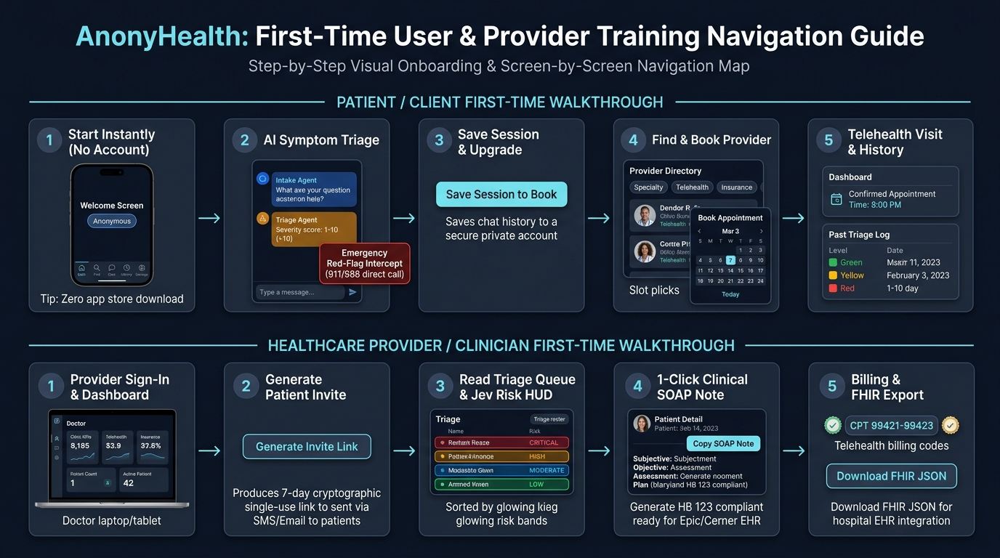

# AnonyHealth — First-Time User & Provider Training Navigation Guide

> **Target Audience:** First-Time Patients (Clients) & Onboarding Healthcare Providers (Physicians/Clinical Staff)  
> **Platform:** AnonyHealth Confidential Telehealth Triage Platform  
> **Interactive Cloud Sandbox:** [https://anonyhealth.alpfr.com/simulation.html](https://anonyhealth.alpfr.com/simulation.html) *(Direct Cloud Run: [https://anonyhealth-cg4uqokewq-uc.a.run.app/simulation.html](https://anonyhealth-cg4uqokewq-uc.a.run.app/simulation.html))*

---

## 🗺️ Visual Onboarding & Screen-by-Screen Navigation Map

<p align="center">
  
</p>

This training guide walks first-time users through the platform step by step. Choose your path below:
- **[Part 1: Patient / Client First-Time Walkthrough (Top Track)](#part-1-patient--client-first-time-walkthrough)**
- **[Part 2: Healthcare Provider First-Time Walkthrough (Bottom Track)](#part-2-healthcare-provider--clinician-first-time-walkthrough)**

---

## 📱 Part 1: Patient / Client First-Time Walkthrough

```
┌─────────────────┐     ┌─────────────────┐     ┌─────────────────┐     ┌─────────────────┐     ┌─────────────────┐
│     STEP 1      │     │     STEP 2      │     │     STEP 3      │     │     STEP 4      │     │     STEP 5      │
│ Start Instantly ├────▶│AI Symptom Triage├────▶│  Save Session   ├────▶│  Find & Book    ├────▶│Telehealth Visit │
│  (No Account)   │     │  & 911 Safety   │     │   & Upgrade     │     │    Provider     │     │   & History     │
└─────────────────┘     └─────────────────┘     └─────────────────┘     └─────────────────┘     └─────────────────┘
```

### Step 1: Start Instantly (Zero Friction, No Account Needed)
* **Screen:** Welcome Dashboard (`/` or from SMS/Email Invite)
* **What You See:**
  * Top-Right Header: **`Anonymous`** pill with a shield icon.
  * Welcome Banner: *"Talk to AI triage, privately. No personal info collected."*
  * Bottom Navigation Bar: **Dash** 🏠, **Find** 🔍, **Chat** 🤖, **History** 🕒, **Settings** ⚙️.
* **Where to Click:** Tap the **Chat** icon in the bottom navigation, or type your symptom directly into the *"Confidential Activity"* search bar on the dashboard.
* **Key Benefit:** **Zero App Store download** and **zero account creation**. You can triage symptoms immediately without entering your name, email, or credit card.

---

### Step 2: Confidential AI Symptom Triage (`AIChatMobile.jsx`)
* **Screen:** AI Triage Chat
* **What You See:**
  * Blue **`Intake Agent`** message bubbles asking 3–5 focused clinical questions (e.g., onset, duration, fever, pain location).
  * Orange **`Triage Agent`** assessment card summarizing your condition with a **Clinical Severity Score (1–10)** and recommended home care steps.
* **🚨 Emergency Safety Intercept:** If you report acute life-threatening symptoms (e.g., *crushing chest pain*, *facial droop*, *severe shortness of breath*, or *suicide crisis*), the **Jev System 1 Reflex Engine** intercepts in **<1 millisecond**:
  * AI chat is instantly suspended.
  * A high-contrast emergency screen appears with direct click-to-call buttons for **911**, the **988 Crisis Lifeline**, and Poison Control.

---

### Step 3: Save Session & Account Upgrade
* **Screen:** Session Save Modal (`/signup`)
* **What You See:**
  * Once triage is complete, a prompt appears: **`SAVE SESSION TO BOOK APPOINTMENT →`**.
  * Heading: *"Save your session"* (retaining your symptom report for your physician).
* **Where to Click:** Enter an email and password, then tap **Save Session**.
* **Key Benefit:** Your anonymous triage history seamlessly carries over into your secure private account. Personal demographics are stored in an encrypted **Identity Vault** separate from your clinical observations.

---

### Step 4: Find & Book a Provider (`Find` Tab)
* **Screen:** Provider Directory & Booking Modal
* **What You See:**
  * Search Bar: Search by physician name, specialty, or condition.
  * Filter Chips: **Specialty** (Primary Care, Cardiology, Urgent Care), **Mode** (Telehealth, In-Person), **Language**, and **Insurance**.
  * Provider Profile Cards with bios, accepted networks, and telehealth badges.
* **Where to Click:**
  1. Tap on your selected doctor's profile.
  2. Tap **`Book Appointment`**.
  3. Select your preferred date on the calendar, pick an available time slot, and tap **Confirm Booking**.

---

### Step 5: Telehealth Visit & Triage History (`Dash` & `History` Tabs)
* **Screen:** Patient Dashboard & Health History
* **What You See:**
  * **Dashboard:** An **Appointments** card displaying your confirmed telehealth visit date, time, and doctor name.
  * **History Screen (`History` tab):** Chronological timeline of past triage interactions color-coded by clinical urgency:
    * 🟢 **Green (Minor):** Self-care and routine monitoring.
    * 🟡 **Yellow (Monitored):** Needs follow-up with a doctor.
    * 🔴 **Red (Urgent):** Immediate clinical attention required.
* **Where to Click:** Tap **`Join Video Visit`** at your appointment time or open **`Messages`** to send secure async updates to your clinician.

---

## 🩺 Part 2: Healthcare Provider / Clinician First-Time Walkthrough

```
┌─────────────────┐     ┌─────────────────┐     ┌─────────────────┐     ┌─────────────────┐     ┌─────────────────┐
│     STEP 1      │     │     STEP 2      │     │     STEP 3      │     │     STEP 4      │     │     STEP 5      │
│ Provider Sign-In├────▶│ Generate Patient├────▶│ Read Triage HUD ├────▶│ 1-Click Clinical├────▶│ CPT Billing &   │
│   & Dashboard   │     │   Invite Link   │     │  & Risk Queue   │     │    SOAP Note    │     │   FHIR Export   │
└─────────────────┘     └─────────────────┘     └─────────────────┘     └─────────────────┘     └─────────────────┘
```

### Step 1: Provider Sign-In & Dashboard Tour
* **Screen:** Provider Sign-In (`/signin` → *"I'm a provider"*) & Clinic Dashboard
* **What You See:**
  * Practice Key Performance Indicators (KPIs): Total Panel Patients, Active Triage Sessions, Pending Consultations.
  * Navigation shortcuts for **Triage Roster**, **Appointments**, and **Practice Profile**.
* **Where to Click:** Log in with your clinic credentials to access the provider management workspace.

---

### Step 2: Generating Patient Invite Links
* **Screen:** Patient Invite Generator Card
* **What You See:** A clean invite generator interface with an option to select patient language or care program.
* **Where to Click:** Click **`Generate Invite Link`**.
* **Action:** Copy the generated cryptographic single-use URL (valid for 7 days) and text or email it to your patient.
* **Why it wins:** Patients join in one tap without account friction, and their triage data routes directly into your panel queue.

---

### Step 3: Navigating the Triage Queue & Jev Risk HUD
* **Screen:** Real-Time Patient Triage Queue
* **What You See:** A live roster of waiting patients, automatically sorted and highlighted by **Jev Clinical Risk Bands**:
  * 🔴 **CRITICAL:** Red-flag emergency or severity 9–10. Immediate clinical outreach required.
  * 🟠 **HIGH:** Urgent appointment needed within 12–24 hours (severity 7–8).
  * 🔵 **MODERATE:** Routine clinical visit appropriate in 3–5 days (severity 4–6).
  * 🟢 **LOW:** Mild presentation suitable for home monitoring (severity 1–3).
* **Where to Click:** Click on any patient card to open their clinical encounter file.

---

### Step 4: 1-Click Clinical SOAP Note Synthesis (`PatientDetailMobile.jsx`)
* **Screen:** Patient Detail & Clinical Documentation
* **What You See:**
  * Full symptom transcript, onset duration, and reported vitals.
  * Pre-generated clinical documentation synthesized into standard **SOAP** format:
    * **S (Subjective):** Patient chief complaint, symptoms, timeline, and severity.
    * **O (Objective):** Verified vitals, telemetry, and red-flag exclusion checklist.
    * **A (Assessment):** Clinical impression, risk tier, and differential considerations.
    * **P (Plan):** Recommended clinical next steps and follow-up timeline.
    * **Maryland Telehealth Act (HB 123):** Embedded statutory telehealth disclosure and consent timestamp.
* **Where to Click:** Click **`Copy SOAP Note`** to instantly copy the structured note to your clipboard and paste into your hospital EHR (**Epic Systems, Oracle Cerner, AthenaHealth**) in 2 seconds.

---

### Step 5: CPT Billing & HL7 FHIR R4 Export
* **Screen:** Billing Decision Support & EHR Interoperability
* **What You See:**
  * **Telehealth Billing Badges:** Suggested digital evaluation codes:
    * **CPT 99421:** Online digital E/M service (5–10 min).
    * **CPT 99422:** Online digital E/M service (11–20 min).
    * **CPT 99423:** Online digital E/M service (21+ min).
  * **ICD-10 Diagnostic Suggestions:** Heuristic diagnosis codes (e.g., `R05.9` Cough, `J02.9` Acute Pharyngitis).
* **Where to Click:**
  * Click **`Download FHIR JSON`** to export an HL7 FHIR R4 Document Bundle (`Patient`, `Condition`, `Observation`, `Encounter`) for automated hospital EHR ingestion.
  * Click **`Confirm Appointment`** or **`Launch Video Visit`** to conduct the telehealth encounter.

---

## 🎮 Practice in the Sandbox Simulator

Want to practice these navigation steps without affecting real patient data?  
👉 **Launch the Interactive Clinical Workflow Simulator:**  
[https://anonyhealth.alpfr.com/simulation.html](https://anonyhealth.alpfr.com/simulation.html) (Direct Cloud Run: [https://anonyhealth-cg4uqokewq-uc.a.run.app/simulation.html](https://anonyhealth-cg4uqokewq-uc.a.run.app/simulation.html))

*Features live, interactive sandbox steps for:*
1. Patient intake dialogue & multi-turn probing
2. Sub-millisecond Jev System 1 emergency red-flag deflection
3. Multi-agent clinical severity scoring
4. 1-Click SOAP note compilation with Maryland HB 123 disclosures
5. CPT 99421–99423 billing calculation and HL7 FHIR R4 JSON export
