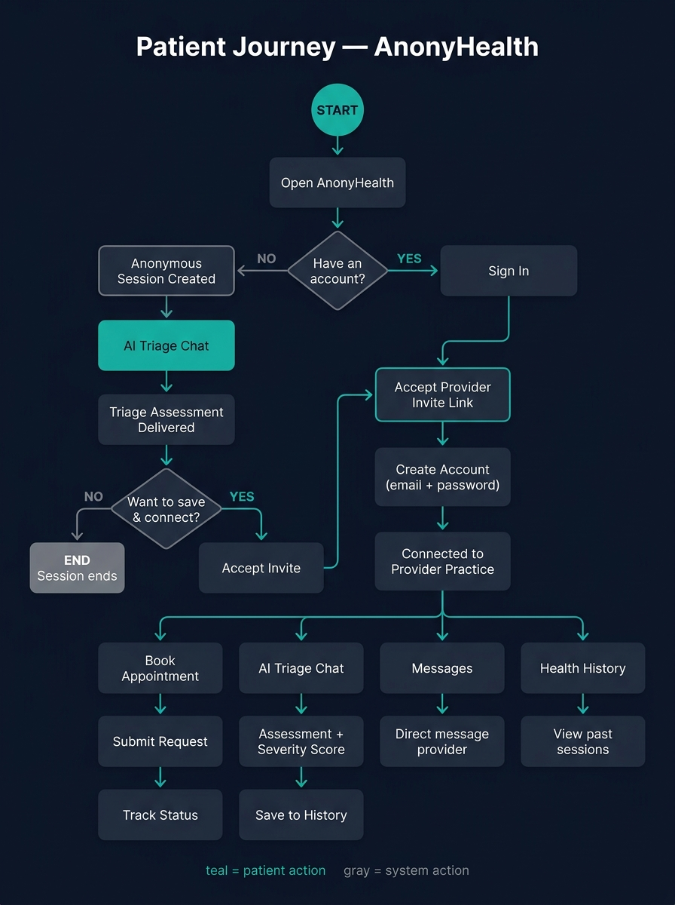
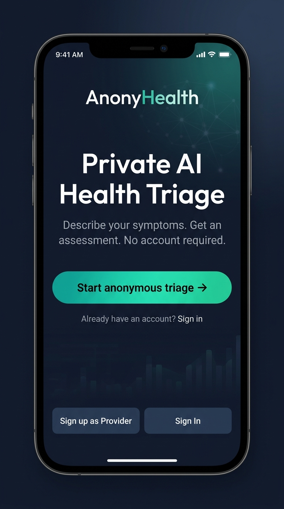
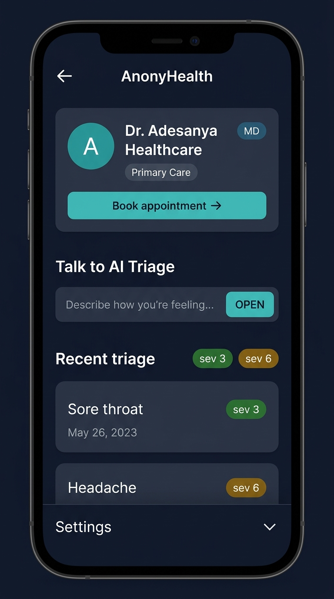
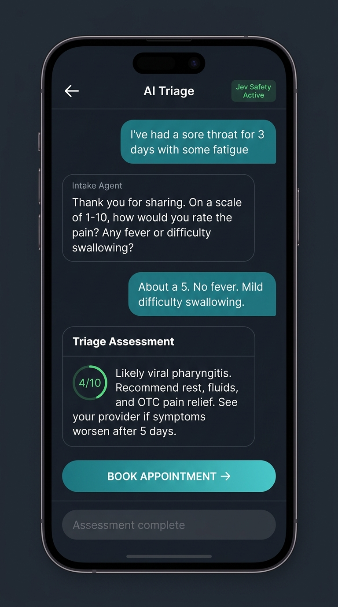
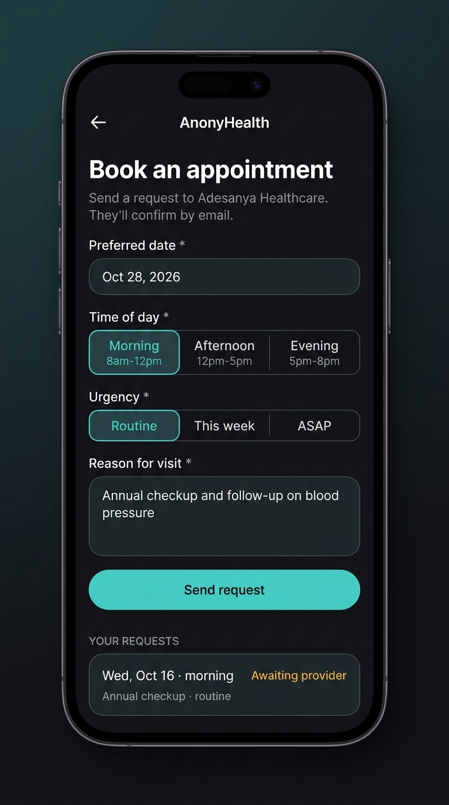

# AnonyHealth — Patient User Guide

**App URL:** https://anonyhealth.alpfr.com  
**Support:** adetola.adesanya@alpfr.com

---

## What is AnonyHealth?

AnonyHealth is a private telehealth platform that lets you get AI-powered health guidance and connect securely with your provider — without requiring you to create an account first.

---

## Getting Started

### Option A — Try it anonymously (no sign-up required)

You can use the AI Triage tool **without creating an account**. This is useful if you want to describe your symptoms and get an initial health assessment before deciding to connect with a provider.

1. Open **https://anonyhealth.alpfr.com** in your mobile browser
2. Tap **"Start anonymous triage"** on the welcome screen
3. Describe how you're feeling in the chat box
4. The AI will guide you through a short intake conversation, then deliver a triage assessment with a severity score and recommended next steps

> **Your privacy:** Anonymous sessions do not store your name, email, or any personally identifiable information.

---

### Option B — Connect with your provider (full access)

Patient accounts are **invite-only** — you can only create a patient account after your provider sends you a personal invite link. This keeps your health data private and ensures you're always connected to a real, verified provider.

1. Open the invite link your provider sent you (it looks like `https://anonyhealth.alpfr.com/invite/...`)
2. Tap **"Accept invite"**
3. Enter your **email address** and create a **password**
4. Complete your profile (name, date of birth)
5. Your account is now connected to your provider — you can access all features

> **Don't have an invite yet?** Ask your provider to generate one from their dashboard. Each invite link is single-use and valid for 7 days.

> **Tip for testers using one email:** If you're testing both roles yourself, use a Gmail plus-alias for the patient account. For example, if your email is `you@gmail.com`, use `you+patient@gmail.com` for the patient signup — Gmail delivers both to the same inbox.

---

## Your Dashboard

After signing in, your dashboard shows:

| Section | What it does |
|---|---|
| **Your provider banner** | Shows your provider's name, credentials, and specialty |
| **Book appointment →** | Submit an appointment request to your provider |
| **Talk to AI Triage** | Type a symptom or health question to start a chat |
| **Recent triage** | Your last AI triage sessions with severity scores |
| **Settings** | Manage account, notifications, and privacy |

---

## AI Triage Chat

The AI Triage tool uses a two-step process:

### Step 1 — Intake
A conversational intake agent asks questions about your symptoms, how long you've had them, and relevant history. Answer naturally — you don't need to use medical terms.

### Step 2 — Triage Assessment
Once enough information is gathered, a triage agent delivers:
- A summary of your reported symptoms
- A **severity score** (1–10)
- Recommended next steps (home care, see a provider, seek urgent care)

> **⚠️ Emergency situations:** If you describe symptoms that suggest a life-threatening emergency (chest pain, difficulty breathing, stroke symptoms, etc.), the app will immediately display an **Emergency Alert** with instructions to call 911. Do not rely on this app for emergencies — always call emergency services directly.

### Tips for best results
- Be specific: *"sharp pain in my lower right abdomen for 2 days"* is better than *"stomach hurts"*
- Mention any relevant history, medications, or allergies when asked
- The chat is locked after the triage assessment is delivered — start a new session for a new concern

---

## Booking an Appointment

### How to submit a request

1. From your dashboard, tap **"Book appointment →"** under your provider's name
2. Fill in the form:
   - **Preferred date** — choose a date (today or later)
   - **Time of day** — Morning (8am–12pm), Afternoon (12pm–5pm), or Evening (5pm–8pm)
   - **Urgency** — Routine, This week, or ASAP
   - **Reason for visit** — brief description (your provider will see this)
3. Tap **"Send request"**

### Tracking your requests

Below the form you'll see **"Your requests"** with the current status of each request:

| Status | Meaning |
|---|---|
| 🟡 **Awaiting provider** | Your request was sent — waiting for your provider to respond |
| 🟢 **Confirmed** | Your provider confirmed the appointment |
| 🔵 **New time proposed** | Your provider suggested a different time — check their note |
| 🔴 **Declined** | Your provider declined — check the provider note for details |
| ⚫ **Cancelled** | You cancelled this request |

You can cancel any request that hasn't been declined by tapping **"Cancel request"**.

---

## Messages

You have a private, direct message thread with your provider.

1. Tap **"Messages"** from your navigation
2. Type your message and tap the send button
3. Your provider will see and reply from their dashboard

Messages are private and only visible to you and your provider.

---

## Health History

Your past triage sessions are saved under **"Recent triage"** on your dashboard.

- Tap **"View all"** to see your full history
- Each entry shows the symptom summary, severity score, and date
- Your provider can reference this history during consultations

---

## Settings

Access **Settings** from your dashboard.

| Setting | Description |
|---|---|
| **Email** | Your registered email address |
| **Provider profile** | (Providers only) Edit your public profile |
| **Appointment reminders** | Toggle on/off — saved across sessions |
| **Updates and news** | Toggle on/off |
| **Anonymize patient activity** | Coming soon |
| **Sign Out** | Log out of your session |

---

## Saving an Anonymous Session

If you used the app anonymously and want to save your triage history:

1. After your triage assessment is complete, tap **"SAVE SESSION TO BOOK APPOINTMENT →"**
2. Sign in or create an account when prompted
3. Your triage session carries over to your account

---

## Frequently Asked Questions

**Q: Do I need an account to use the AI chat?**  
A: No. AI Triage works completely anonymously without signing up.

**Q: How do I get connected to a provider?**  
A: You need an invite link from your provider. Ask your provider to generate and share one with you.

**Q: Is my health information private?**  
A: Yes. Your data is stored securely and is not shared with third parties or advertisers.

**Q: Can I use AnonyHealth on my computer?**  
A: Yes — it works in any modern browser on mobile or desktop. It is optimized for mobile.

**Q: What if I have a medical emergency?**  
A: Call **911** immediately. Do not use this app for emergencies.

**Q: How do I reset my password?**  
A: On the sign-in screen, tap **"Forgot password?"** and enter your email. You'll receive a reset link.

---

*AnonyHealth v1.0 · For support contact adetola.adesanya@alpfr.com*
