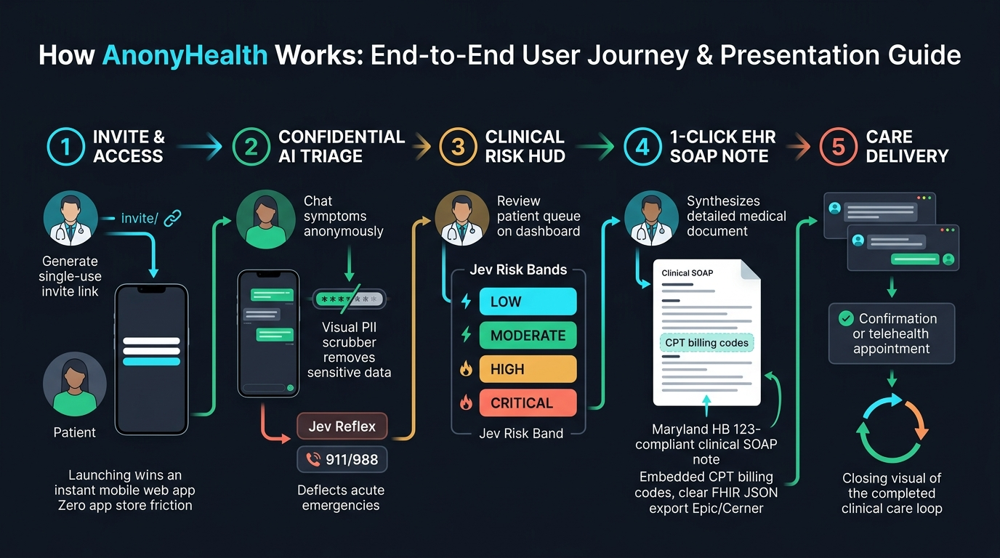

# How AnonyHealth Works: Presentation & Demo Guide

> **Audience:** Clinical Stakeholders, Practice Administrators, Investors, and Product Demonstrators  
> **Interactive Cloud Endpoint:** [https://anonyhealth-cg4uqokewq-uc.a.run.app](https://anonyhealth-cg4uqokewq-uc.a.run.app)  
> **Repository:** [https://github.com/alpfr/anonyhealth.git](https://github.com/alpfr/anonyhealth.git)

---

## 1. End-to-End User Journey Presentation Diagram

  

---

## 2. The 5-Step Presentation Narrative

### Step 1: Frictionless Access & Zero App Friction
* **The Doctor Action:** The physician opens their practice management portal and clicks **"Generate Invite Link"**. A cryptographic, single-use URL is generated (valid for 7 days).
* **The Patient Experience:** The patient receives the link via SMS or email and opens it in their mobile or desktop browser.
* **Why it wins:** **No App Store download required.** No passwords or credit card forms before care. Zero onboarding friction.

### Step 2: Confidential AI Triage & Sub-Millisecond Emergency Shield
* **The Patient Experience:** The patient engages in a private, natural conversational intake describing their symptoms in English or Spanish.
* **Zero-Knowledge Privacy:** The client-side PII scrubber removes Social Security numbers, phone numbers, and emails before data leaves the device.
* **Deterministic Emergency Intercept:** If acute red-flag symptoms are detected (e.g. crushing chest pain, facial droop, airway swelling, infant fever, or suicidal crisis), the **Jev System 1 Reflex Engine** triggers an immediate (<1ms, $0 cost) emergency modal with direct tap-to-call links (`911`, `988` Crisis Lifeline, Poison Control).
* **Non-Emergent Guidance:** If non-emergent, the multi-agent AI provides personalized guidance, home care instructions, and a clinical severity rating (1–10).

### Step 3: Real-Time Clinical Risk HUD
* **The Doctor Action:** The physician's dashboard updates in real time with the new intake.
* **Jev Risk Stratification:** Entries are automatically stratified into high-visibility risk tiers:
  * 🔴 **CRITICAL:** Immediate red-flag deflection or severity 9–10.
  * 🟠 **HIGH:** Urgent appointment needed within 12–24 hours (severity 7–8).
  * 🔵 **MODERATE:** Routine clinical visit (severity 4–6).
  * 🟢 **LOW:** Home care & self-monitoring (severity 1–3).

### Step 4: 1-Click EHR Documentation & Billing Decision Support
* **The Problem Solved:** Doctors spend 2+ hours every evening manually typing SOAP notes ("pajama time").
* **The 1-Click Solution:** The physician clicks **"Copy SOAP Note"** or **"Preview"**:
  * Synthesizes a structured `Subjective`, `Objective`, `Assessment`, and `Plan` document.
  * Embeds **Maryland Telehealth Act (HB 123)** compliance disclosures.
  * Suggests telehealth billing codes: **CPT 99421–99423** (digital evaluation & management) and heuristic **ICD-10** diagnosis codes.
  * Ready to paste into hospital EHRs (Epic, Cerner, AthenaHealth) in 2 seconds.
* **Interoperability:** Clinicians can click **"Download FHIR JSON"** to export an HL7 FHIR R4 document bundle for automated EHR API ingestion.

### Step 5: Care Coordination & Closed-Loop Follow-Up
* **Closing the Loop:** The provider confirms appointments, sends secure asynchronous follow-up messages, or conducts telehealth video consultations.
* **Zero-Trace Privacy:** An automatic 15-minute inactivity hook purges temporary drafts and session cache from client memory.

---

## 3. Live 3-Minute Demo Script

When demonstrating the platform to stakeholders:

1. **Show Patient Intake:**
   - Navigate to [https://anonyhealth-cg4uqokewq-uc.a.run.app](https://anonyhealth-cg4uqokewq-uc.a.run.app).
   - Enter symptom: *"Persistent dry cough and mild fever 99.8F for 2 days"*.
   - Show natural conversational response, severity rating (4/10), and home care plan.
2. **Show Emergency Intercept:**
   - In a new message, type: *"I have crushing chest pain radiating to my left arm"*.
   - Point out the **0ms instantaneous intercept**: the red emergency card immediately halts AI chat and presents direct 911 / 988 call buttons.
3. **Show Doctor Workflow & EHR Integration:**
   - Open Doctor View / Patient Detail.
   - Show the **JEV: MODERATE** badge.
   - Click **"Preview"** to display the generated Clinical SOAP Note with CPT 99422 and ICD-10 `R05.9`.
   - Click **"Download FHIR JSON"** to demonstrate hospital interoperability.
