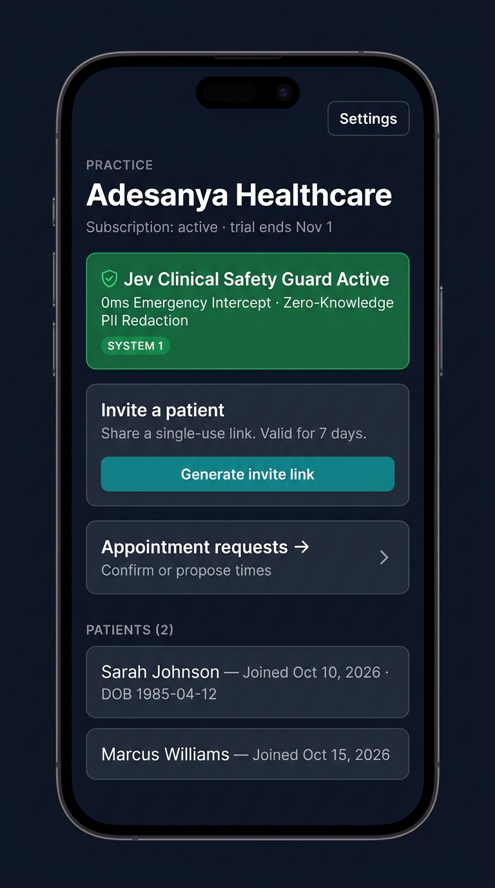
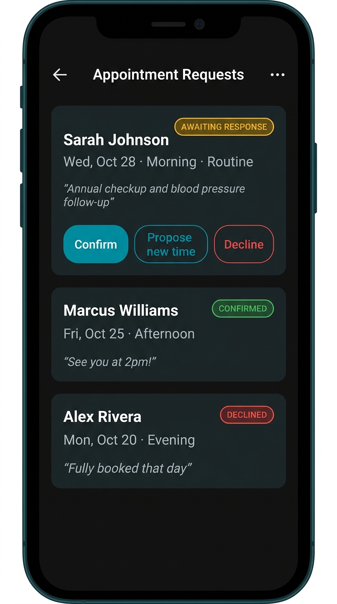

# AnonyHealth — Provider User Guide

**App URL:** https://anonyhealth.alpfr.com  
**Support:** adetola.adesanya@alpfr.com

---

## What is AnonyHealth?

AnonyHealth is a private telehealth platform that lets you manage patients, respond to appointment requests, send direct messages, and configure your practice profile — all from a mobile-first dashboard.

---

## Getting Started as a Provider

### Step 1 — Create your provider account

1. Open **https://anonyhealth.alpfr.com**
2. Tap **"Sign up as a provider"** on the welcome screen
3. Enter your **email address** and create a **password**
4. Enter your **practice name** when prompted — this is what patients will see
5. Your provider dashboard will load

> **Billing:** After your free trial, a subscription is required to keep your practice active. You can manage billing at any time from Settings → Manage billing.

---

### Step 2 — Set up your provider profile

Your profile is what patients see on their dashboard when they're connected to your practice.

1. Go to **Settings → Provider profile**
2. Fill in:
   - **Display name** *(required)* — your name as patients will see it (e.g. "Dr. Jane Smith")
   - **Credentials** — e.g. MD, NP, LCSW, PA-C
   - **Specialty** — e.g. Primary Care, Dermatology, Mental Health
   - **Bio** — a brief description of your practice and approach (up to 4,000 characters)
   - **Avatar URL** — optional link to a public profile photo
   - **Scheduling link** — optional direct link to your online booking page (see below)
3. Tap **"Save & close"**

#### Optional: Scheduling link
If you use an external booking tool (Calendly, Cal.com, SavvyCal, etc.), paste the **specific event URL** here so patients can book directly.

> ⚠️ **Important:** Link to a specific appointment type, not your profile root.
> - ✅ Correct: `https://calendly.com/your-name/telehealth-appointment`
> - ❌ Incorrect: `https://calendly.com/your-name`

Use the **"Test link in new tab"** button to confirm it opens the right booking page before saving.

If you leave this blank, patients will use AnonyHealth's built-in appointment request form instead — no external booking tool needed.

---

### Step 3 — Invite your first patient

Each patient must be individually invited — patients cannot self-register. This protects your practice by ensuring only people you've invited can connect to your account.

1. From your provider dashboard, tap **"Generate invite link"**
2. A single-use invite link is created — valid for **7 days**
3. Tap **"Copy link"** and share it with your patient via email, SMS, or any channel you prefer
4. When the patient opens the link and creates their account, they'll appear in your **Patients** list automatically

> **Each invite link is single-use and expires after 7 days.** If a patient's link expires before they sign up, generate a new one.

> **Testing tip:** If you want to test the patient experience yourself without a second email address, you can use a **Gmail plus-alias**. For example, if your provider account uses `you@gmail.com`, generate an invite and sign up the patient side using `you+patient@gmail.com` — Gmail delivers both to the same inbox. Open the patient session in an **incognito / private browser window** so both sessions stay separate.

---

## Provider Dashboard

Your dashboard gives you an overview of your practice:

| Section | What it shows |
|---|---|
| **Practice name** | Your registered practice name and subscription status |
| **Jev Clinical Safety Guard** | Confirms the AI safety system is active for all patient chats |
| **Invite a patient** | Generate and copy a new patient invite link |
| **Appointment requests** | View and respond to all pending appointment requests |
| **Patients** | List of all connected patients — tap any patient to view their detail |

---

## Managing Appointment Requests

Patients use the built-in form to request appointments. You receive all requests in one place.

### To view requests
1. From your dashboard, tap **"Appointment requests"**
2. All pending and past requests are listed with the patient name, preferred date, time window, urgency, and reason

### To respond to a request

On each request you have three options:

| Action | When to use |
|---|---|
| **Confirm** | The requested date/time works — confirm the appointment |
| **Propose new time** | The requested date/time doesn't work — suggest an alternative |
| **Decline** | You're unable to accommodate the request |

#### Confirming
Tap **"Confirm"** — the patient's status immediately changes to **Confirmed** (shown in green on their dashboard).

#### Proposing a new time
1. Tap **"Propose new time"**
2. Enter your suggested date and time
3. Optionally add a **provider note** to explain (e.g. *"That date is fully booked, does Thursday at 2pm work?"*)
4. Tap **"Propose"** — patient sees status **New time proposed** (blue) with your note

#### Declining
1. Tap **"Decline"**
2. Optionally add a **provider note** with the reason
3. Patient sees status **Declined** (red) with your note

### Appointment request statuses

| Status | Meaning |
|---|---|
| 🟡 **Requested** | Patient submitted — awaiting your response |
| 🟢 **Confirmed** | You confirmed the appointment |
| 🔵 **Counter proposed** | You proposed a new time — awaiting patient acknowledgement |
| 🔴 **Declined** | You declined the request |
| ⚫ **Cancelled** | Patient cancelled the request |

---

## Patient Detail View

Tap any patient name in your patient list to open their detail view. This shows:

- **Patient profile** — name, date of birth (if set by the patient)
- **Health history** — all AI triage sessions, each with symptom summary and severity score
- **Messages** — your direct message thread with this patient

Use this view to review a patient's triage history before or during a consultation.

---

## Messages

You have a private, direct message thread with each connected patient.

1. Open a patient's detail view
2. Tap **"Messages"**
3. Type your message and tap send
4. The patient receives the message in their Messages tab

Messages are real-time and only visible to you and the patient.

---

## Billing & Subscription

AnonyHealth uses a subscription model to keep your practice active.

### To manage your subscription
1. Go to **Settings → Manage billing**
2. You'll be redirected to the secure Stripe billing portal
3. From here you can:
   - Update your payment method
   - View past invoices
   - Cancel or change your plan

### What happens if a subscription lapses?
If your subscription expires or payment fails, your practice will be placed in an **inactive state**. Patients will not be able to access provider-gated features until the subscription is restored.

---

## Settings

Access **Settings** from the top-right corner of your dashboard.

| Setting | Description |
|---|---|
| **Email** | Your registered email address |
| **Provider profile** | Edit your display name, credentials, specialty, bio, avatar, and scheduling link |
| **Manage billing** | Open the Stripe billing portal |
| **Export my data** | Download a JSON bundle of all patient data for your practice |
| **Appointment reminders** | Toggle on/off (for your own notifications) |
| **Sign Out** | Log out of your session |

---

## Exporting Patient Data

You can export a complete data bundle for compliance or record-keeping purposes:

1. Go to **Settings → Export my data**
2. A JSON file (`anonyhealth-export.json`) is downloaded to your device
3. This file contains all patient records, triage logs, messages, and appointment data for your practice

---

## Frequently Asked Questions

**Q: How do I add a new patient?**  
A: Generate an invite link from your dashboard and share it with your patient. Each link is single-use and expires after 7 days.

**Q: A patient says their invite link expired. What do I do?**  
A: Generate a new invite link for them — just tap "Generate invite link" again.

**Q: Do I need Calendly or another booking tool?**  
A: No. The built-in appointment request system works without any external tools. The scheduling link field is optional — leave it blank and patients will use the built-in form.

**Q: Can patients see each other's data?**  
A: No. Patient data is strictly isolated — each patient only sees their own records.

**Q: What is the Jev Clinical Safety Guard?**  
A: Jev is AnonyHealth's AI safety system. It monitors all patient AI triage chats in real time and intercepts emergency situations — automatically showing the patient an emergency alert with 911 instructions if life-threatening symptoms are described.

**Q: How do I reset my password?**  
A: On the sign-in screen, tap **"Forgot password?"** and enter your email. You'll receive a reset link.

**Q: Can I use AnonyHealth on my computer?**  
A: Yes — it works in any modern browser on mobile or desktop.

---

*AnonyHealth v1.0 · For support contact adetola.adesanya@alpfr.com*
